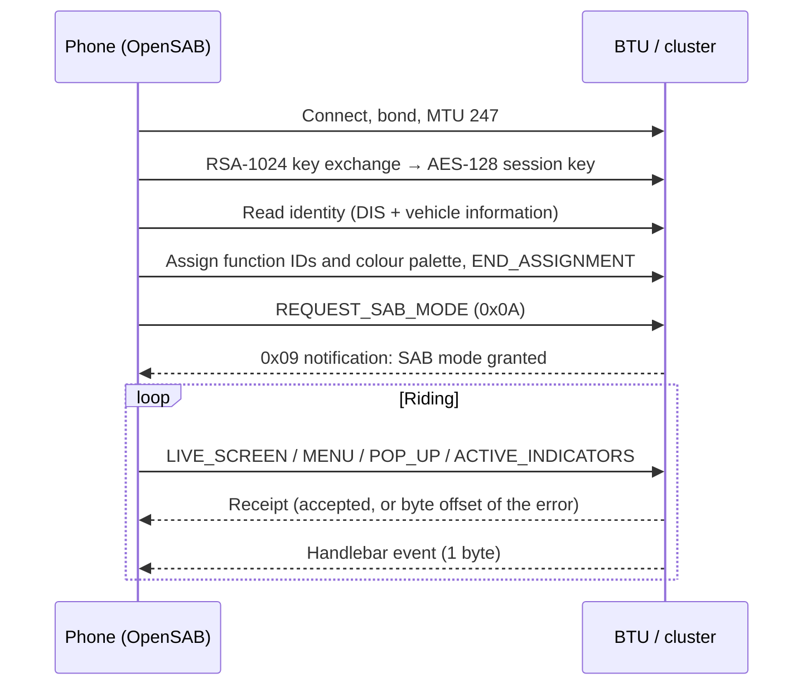
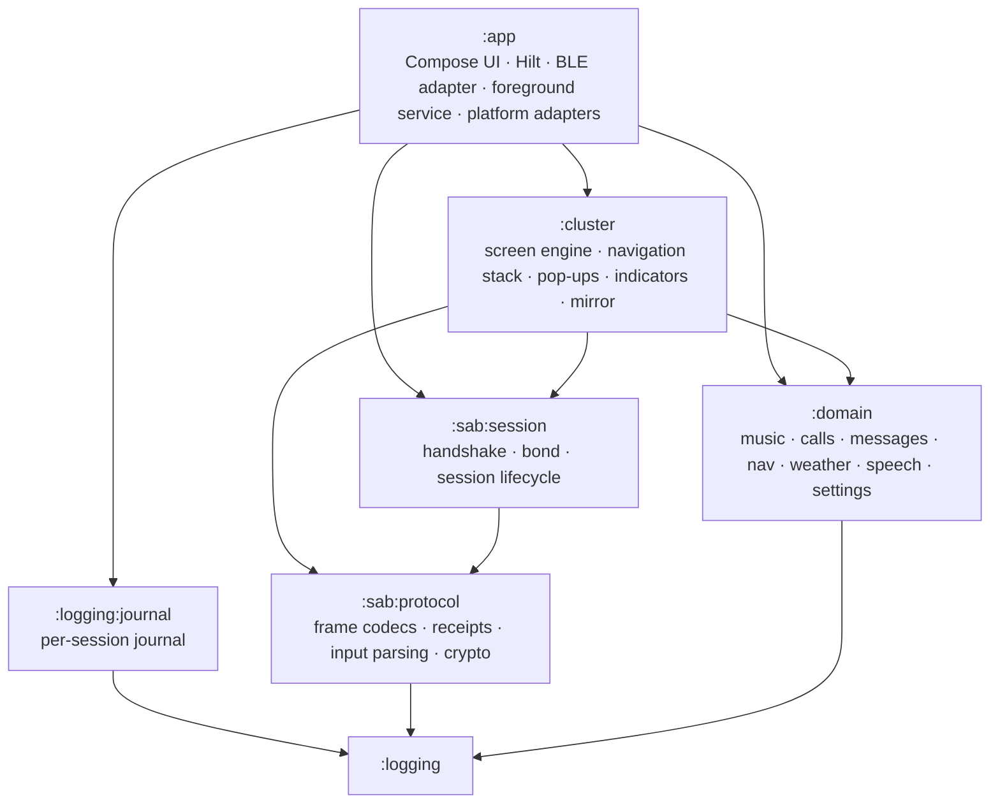

# OpenSAB

**An open Android client for the Bluetooth Telematics Unit (BTU) in recent Honda motorcycles.**
It pairs over BLE, drives the instrument cluster as a remote display and takes input from the
handlebar switches. No cloud, no account, no root.


[](LICENSE)


---

## Why this exists

Honda BTU-equipped bikes can show music, calls, messages and turn-by-turn directions on the
dashboard, but only through a closed companion app. The bike is a thin terminal: it renders whatever
frames the phone sends and reports which button was pressed. All the logic lives on the phone.

OpenSAB replaces that app with one that runs entirely on the device. The BLE protocol it speaks was
documented from scratch through independent protocol analysis, then implemented test-first against
byte-level golden vectors and validated on a real bike.

## Features

| Area | What the rider gets |
|---|---|
| **Music** | Now-playing screen, pause and skip, volume from the handlebar, for any player that exposes Android's media controls; optionally starts your music when the bike connects |
| **Calls** | Incoming call screen with answer and decline; dial a starred contact or say a name |
| **Messages** | New messages from the common messaging apps announced, shown and read aloud; reply by voice or with a canned answer; write a new SMS from the handlebar |
| **Navigation** | The next turn from Google Maps guidance on the cluster, with its arrow and distance; start a route by saying the destination |
| **Weather** | Current conditions and the next hours from Open-Meteo, no API key |
| **Voice** | The phone's text-to-speech and speech recognition, routed through the helmet headset; short sound cues so you know where you are without looking |
| **Indicators** | Source state (calls, messages, navigation…) mapped to the cluster's permanent indicator bar |
| **Dashboard** | The phone shows a live mirror of what is on the cluster, rendered from the same page model |

What is not there yet, and the known limits of each feature, are listed in the
[wiki](../../wiki).

Everything runs in a foreground service. The only network call is the weather lookup.

## Hardware

| | Verified |
|---|---|
| Motorcycle | Honda CB650R / CBR650R, 2024 (platform `0536`) |
| Display | 5" colour TFT |
| Handlebar control | Left 4-way switch |
| Phone | Google Pixel 7, stock, unrooted |

That is the only bike it has been tested on. Other BTU-equipped Hondas should work. There is no model catalogue: when pairing a new bike, the app
asks whether the cluster is colour TFT or segment LCD, and adapts:

- **Colour TFT:** full RGB palette. Modal pop-ups are used only if the unit declares support for them;
  otherwise they fall back to indicator icons without interrupting the current screen.
- **Segment LCD:** colours fold deterministically to monochrome and non-ASCII text is transliterated
  before it reaches the display.

## How a session works



Two quirks shaped most of the design:

- **The cluster boots in its own mode and silently drops every frame** until the phone requests SAB
  mode. The answer never arrives in the request's receipt; it comes later as a separate notification.
  There is no command to hand control back; that is the rider's call.
- **Optional fields are omitted, not zeroed.** Writing `0x00` for an absent field shifts every later
  offset and the unit rejects the frame, pointing at the offending byte in the receipt. Codecs are
  tested against the exact bytes that go on the wire for that reason.

## Architecture

Seven Gradle modules. Only `:app` is an Android module; everything below it is plain JVM Kotlin, so
the protocol, session and screen engine cannot import the Android framework: the build fails
if they try.



Design choices worth knowing:

- **A page is the unit of screen.** Each `PageProvider` renders the binary frame for the cluster
  *and* a semantic mirror for the phone dashboard from the same state at the same instant, so the
  two cannot drift. `mirror()` has no default implementation: a page that forgets it doesn't compile.
- **One operation in flight on GATT.** Writes go through a serialized queue; Android's BLE stack
  fails quietly when operations overlap.
- **Single ownership.** Every shared resource (a coroutine scope, a timer, the write path to the
  control point) has exactly one owner, named in its KDoc. The hardest bugs found on the bike were
  all ownership bugs that no unit test could see in isolation.
- **Domain sources hold state only.** Music, calls, navigation and the rest know nothing about icon
  IDs or indicator bits; the engine maps state to protocol. Each Android API sits behind one adapter
  in `:app`.
- **Stack:** Kotlin 2.4, coroutines and `Flow`, Jetpack Compose with per-screen MVI, Hilt,
  DataStore, kotlinx.serialization.

## Testing

- **2,500+ JVM unit tests** (JUnit 4, `kotlinx-coroutines-test`, Turbine). CI fails if the count
  drops below a pinned threshold, so the suite can only grow.
- **Golden vectors first.** Codec tests start from byte sequences in the protocol notes, confirmed
  against real captures, never from the encoder under test.
- **End-to-end on the JVM.** A `BtuSimulator` speaks the protocol over a mock GATT transport and the
  tests assert on the bytes that reach the wire, the only reliable way to catch a misplaced offset.
- **No Robolectric.** Platform code is kept thin and tested above the seam with pure tests, or on a
  real device.
- **Field runs.** Every protocol change is checked on the bike, with HCI snoop captures and device
  logs.

## Installing

Signed APKs are attached to each [release](../../releases), with their SHA-256 checksum. There is no
store listing. Android 8.0 or newer with Bluetooth Low Energy; no Google account, no Play Services.
Step by step, including the first launch and pairing, on the *Installing* page of the
[wiki](../../wiki).

## Documentation

The [wiki](../../wiki) has three parts: for riders (pairing, the switches, each feature and its
limits, troubleshooting), for developers (architecture, building, writing a page) and the protocol
itself, frame by frame, with byte vectors checked against the test suite.

## Building

Requirements: JDK 17+, Android SDK 37.

```bash
./gradlew unitTests                 # unit suite, all modules
./gradlew :app:assembleDebug        # debug APK
./gradlew koverHtmlReport           # aggregated coverage report
```

On first launch the app asks for Bluetooth, notification access (for navigation, messages and media
metadata), contacts, SMS, phone, microphone and location (for weather). Each one only unlocks the
feature that needs it; the rest keep working without it.

## A note on the crypto

The session uses RSA-1024 and AES-128 in ECB mode. Neither would be chosen today, but both are
dictated by the BTU firmware; the app has to speak what the bike speaks. The negotiated session key
is stored sealed with an AES-256-GCM key that never leaves the Android Keystore; if it can no longer
be opened, the next connection simply runs a fresh key exchange.

## Contributing traces

Owners of other BTU-equipped Hondas can help most by sharing the log of one connection, made with
a debug build: the bike model, what the app showed and what the cluster did. How to get the log and
how to clean it of names, numbers and message text is on the *Contributing Traces* page of the
[wiki](../../wiki). "It worked" is a useful report too.

## Legal

OpenSAB is an independent project and is not affiliated with, endorsed by or supported by Honda
Motor Co., Ltd. "Honda" and model names are trademarks of their owners and are used here only to
describe compatibility. The protocol was documented for the sole purpose of interoperability and the
app contains no third-party code. Use it at your own risk and never interact with the phone while
riding.

## License

Copyright (C) 2026 The OpenSAB contributors

OpenSAB is free software: you can redistribute it and/or modify it under the terms of the
[GNU General Public License](LICENSE) as published by the Free Software Foundation, either version 3
of the License, or (at your option) any later version. It is distributed in the hope that it will be
useful, but WITHOUT ANY WARRANTY; see the license for details.
